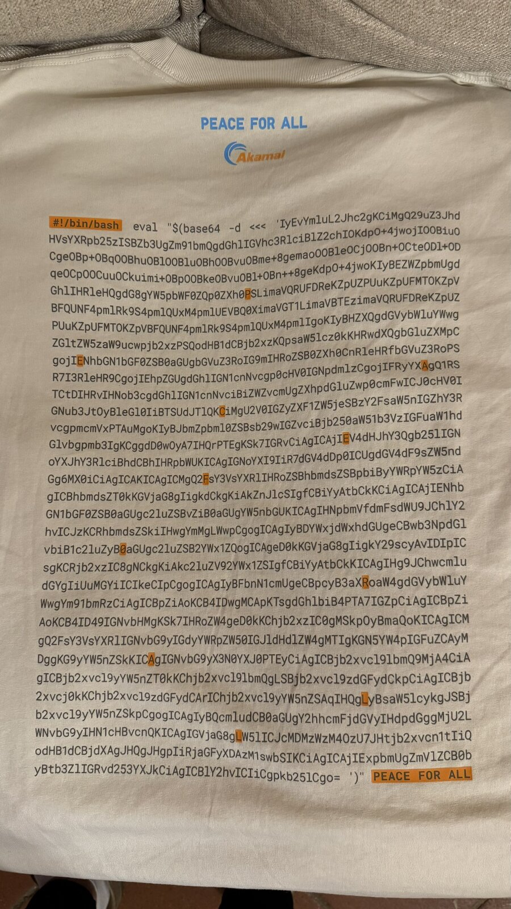

# UNIQLO × Akamai "PEACE FOR ALL" T-shirt

I got a T-shirt from the UNIQLO **PEACE FOR ALL** collection as a Christmas present. The design by Akamai has a block of code printed on the back. This repository contains the code, its decoded version and an explanation of what it does.

<p align="center"></p>

## What's printed on the shirt

The shirt carries a one-line bash script, transcribed in [`script.sh`](script.sh):

```bash
#!/bin/bash
eval "$(base64 -d <<< 'IyEvYmluL2Jhc2gKCiMgQ29uZ3Jhd...')"
```

It decodes a base64 string and immediately runs the result with `eval`. Running code you can't read is exactly how malware spreads, so before executing it I wanted to see what was inside.

Some characters in the printed block are highlighted in orange: read in order, they spell **PEACE FOR ALL**.

## Decoding it safely

Replacing `eval` with `echo` makes the script print the hidden code instead of running it:

```bash
echo "$(base64 -d <<< '...')"
```

The result is in [`decoded_script.sh`](decoded_script.sh). It opens with an easter-egg greeting in English and Japanese:

```bash
# Congratulations! You found the easter egg! ❤️
# おめでとうございます！隠されたサプライズを見つけました！❤️
```

## What the code does

Once I knew it was harmless, I ran it: it's a small terminal animation. In an endless loop the script:

1. takes the next character of `♥PEACE♥FOR♥ALL♥…`;
2. computes a horizontal position as `cols/2 + cols/4 · sin(0.2 · t)`, so the letters swing left and right in a wave;
3. picks a 256-color ANSI code that shifts at every line;
4. prints that single character and moves to the next line, so the message scrolls down the screen.

It hides the cursor while running and restores it when you press <kbd>Ctrl</kbd>+<kbd>C</kbd>.

To try it yourself (it needs `bc`, preinstalled on macOS and most Linux distributions):

```bash
bash script.sh
```

## Files

| File | Content |
| --- | --- |
| [`script.sh`](script.sh) | The script as printed on the shirt |
| [`decoded_script.sh`](decoded_script.sh) | The decoded code |
| [`tshirt.jpeg`](tshirt.jpeg) | Photo of the shirt |

The script belongs to its authors (UNIQLO and Akamai) and is included here for documentation.
